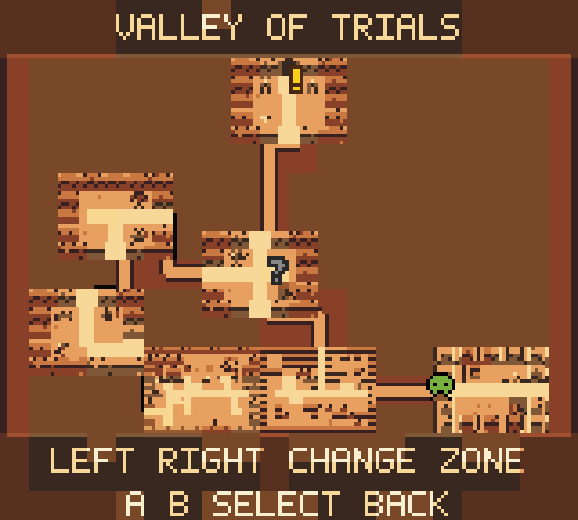
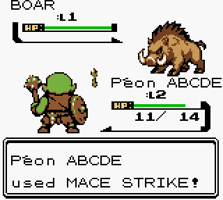

# Peon of Warcraft — Durotar prototype

[ROM v0.2.12](releases/v0.2.12/peon_of_warcraft_v0_2_12.gbc) · [Téléchargement ZIP](releases/v0.2.12/peon_of_warcraft_v0_2_12.zip) · [Réparations graphiques, sources et quête tellurique](docs/ART_REPAIR_AND_EARTH_STONE_V0212.md)

La v0.2.12 utilise les grandes planches de héros validées disponibles, les PNG
canoniques pour les PNJ et des intérieurs dégagés. Elle ajoute le shaman
mystérieux en zone 2 et la victoire, l'échange puis la capture et le renommage
d'un élémentaire en zone 3. Les sources originales restent intactes ; le
document précise les conversions avec perte et les vues sources endommagées.

Safe native build: `python3 tools/build_peon_art_repair_v0212.py`.

## v0.2.11 archive

[Previous ROM — v0.2.11](https://raw.githubusercontent.com/GASPARDWALT/peon-of-warcraft/refs/heads/main/releases/v0.2.11/peon_of_warcraft_v0_2_11.gbc) · [ROM and native validation](https://raw.githubusercontent.com/GASPARDWALT/peon-of-warcraft/refs/heads/main/releases/v0.2.11/peon_of_warcraft_v0_2_11.zip) · [PNG sources, completed sprites and real captures](https://raw.githubusercontent.com/GASPARDWALT/peon-of-warcraft/refs/heads/main/references/generated/user_art_v0211_pack/peon_png_sources_and_completions_v0_2_11.zip) · [Offline browser player](https://raw.githubusercontent.com/GASPARDWALT/peon-of-warcraft/refs/heads/main/releases/browser-player-v0.2.11/peon_of_warcraft_v0_2_11_player.zip)

This previous release introduced the character/scenery import paths and
separate completions. Its procedural hero completions are superseded by the
v0.2.12 approved raster imports. The previous release and its reports remain
archived; they do not describe the current graphics.

The supplied Razor Hill inn model covers the nine enterable buildings and two
closed guard lodges. Five room layouts reuse its native interior tiles. Roofs
render in front of actors; body walls, existing door routes and old-save safe
landings are checked. Compact resource/cost text keeps the entire combat sprite
visible during move selection. Three native class routes, all nine doors,
SAVE/EXIT/Continue, an actual old-save relocation and browser playback pass on
the packaged ROM. Physical Chromatic/DevDay hardware remains untested.

See [import details and reproducible build](docs/USER_ART_V0211.md) and
[the source/actual-ROM gallery](references/generated/user_art_v0211_pack/index.html).

[Previous ROM — v0.2.10](https://raw.githubusercontent.com/GASPARDWALT/peon-of-warcraft/refs/heads/main/releases/v0.2.10/peon_of_warcraft_v0_2_10.gbc) · [ROM and EXIT test reports](https://raw.githubusercontent.com/GASPARDWALT/peon-of-warcraft/refs/heads/main/releases/v0.2.10/peon_of_warcraft_v0_2_10.zip) · [Offline browser player](https://raw.githubusercontent.com/GASPARDWALT/peon-of-warcraft/refs/heads/main/releases/browser-player-v0.2.10/peon_of_warcraft_v0_2_10_player.zip)

Selecting **EXIT** now returns to the Peon title screen. Release the confirmation
button, then press **START** to open character selection and Continue from the
last native SAVE. B still closes the menu. Saved progress is preserved; EXIT
does not create a new save. All three classes pass the native and browser
return/reload checks, including a held confirmation button.
See [the change and checks](docs/V0_2_10_EXIT_TO_TITLE.md).

[Previous ROM — v0.2.9](https://raw.githubusercontent.com/GASPARDWALT/peon-of-warcraft/refs/heads/main/releases/v0.2.9/peon_of_warcraft_v0_2_9.gbc) · [ROM + verified reports](https://raw.githubusercontent.com/GASPARDWALT/peon-of-warcraft/refs/heads/main/releases/v0.2.9/peon_of_warcraft_v0_2_9.zip) · [v0.2.9 PNG, animations and gallery](https://raw.githubusercontent.com/GASPARDWALT/peon-of-warcraft/refs/heads/main/releases/v0.2.9/peon_of_warcraft_v0_2_9_assets.zip) · [Browser player v0.2.9](https://raw.githubusercontent.com/GASPARDWALT/peon-of-warcraft/refs/heads/main/releases/browser-player-v0.2.9/peon_of_warcraft_v0_2_9_player.zip)

The v0.2.9 foundation adds real two-to-three-member parties, mana/rage, class
recruitment and successive Kolkar/cave/Road packs. Six new character sets have
three native combat poses; spell projectiles, TEAM font restoration, capture
retirement and old-save collision migration are validated on the delivered ROM.
The original save layout and four-action records remain. The three classes,
ordinary recruits, cold saves, 63 older location saves, native graphics and
self-contained browser controls pass. Hardware Chromatic/DevDay tests remain
outstanding. See [current scope and save notes](docs/V0_2_9_PLAYABLE_BUILD.md),
[stability evidence](docs/QA_STABILITY_V029.md) and
[visual gallery](references/generated/stability_v029/index.html).

[Previous ROM — v0.2.7](https://raw.githubusercontent.com/GASPARDWALT/peon-of-warcraft/refs/heads/main/releases/v0.2.7/peon_of_warcraft_v0_2_7.zip) · [Browser player v0.2.7](https://raw.githubusercontent.com/GASPARDWALT/peon-of-warcraft/refs/heads/main/releases/browser-player-v0.2.7/peon_of_warcraft_v0_2_7_player.zip) · [Opening palm and verification](docs/V0_2_7_OPENING_PALM.md)

The opening Peon now sleeps beside a palm. The hunter's approach, BONK,
class choice and arrival at The Den pass for all three classes, as do browser
play, native saves and cold Continue.

[Previous ROM — v0.2.6](https://raw.githubusercontent.com/GASPARDWALT/peon-of-warcraft/refs/heads/main/releases/v0.2.6/peon_of_warcraft_v0_2_6.zip) · [Transparent PNGs, captures and offline gallery](https://raw.githubusercontent.com/GASPARDWALT/peon-of-warcraft/refs/heads/main/releases/v0.2.6/peon_of_warcraft_v0_2_6_assets.zip) · [Changes, save transfer and verification](docs/V0_2_6_VISUAL_POLISH.md)

[Browser player v0.2.6](https://raw.githubusercontent.com/GASPARDWALT/peon-of-warcraft/refs/heads/main/releases/browser-player-v0.2.6/peon_of_warcraft_v0_2_6_player.zip) · [Browser controls and web hosting](docs/BROWSER_PLAYER_V026.md)

The visual pass adds distinct low-level Warrior/Warlock graphics, a smaller
world imp, larger battle companions, animated Firebolt and purple Shadow Bolt,
clearer native entrances and a revised Horde emblem. Normal text is light;
person names alone use heavier glyphs. It fixes name/palette corruption while
typing, scrolling, casting and returning from menus. All three class routes,
doors, browser play and genuine v0.2.5 save upgrades are checked on the exact
delivered ROM. Physical Chromatic/DevDay validation remains outstanding.

[Previous ROM — v0.2.5](https://raw.githubusercontent.com/GASPARDWALT/peon-of-warcraft/refs/heads/main/releases/v0.2.5/peon_of_warcraft_v0_2_5.zip) · [v0.2.5 art/gallery](https://raw.githubusercontent.com/GASPARDWALT/peon-of-warcraft/refs/heads/main/releases/v0.2.5/peon_of_warcraft_v0_2_5_assets.zip) · [v0.2.5 instructions](docs/V0_2_5_ENVIRONMENT.md)

[Browser player download — same v0.2.5 ROM](https://raw.githubusercontent.com/GASPARDWALT/peon-of-warcraft/refs/heads/main/releases/browser-player-v0.2.5/peon_of_warcraft_v0_2_5_player.zip) · [Browser controls, save files and web hosting](docs/BROWSER_PLAYER_V025.md). The self-contained reader adds keyboard/touch controls, audio and save import/export; its native ROM is unchanged.

The Valley now has seven connected areas following the annotated geography:
Den east to the Valley, north to the crossroads, west to Hana'zua, south to
Sarkoth, north to the cave approach, and east through the fortified exit.
Old duplicate quest actors and the former cave entry are retired. All 47
native decoration blocks are redrawn, building openings align with their
real thresholds, fires animate and the fixed-cell font is easier to read.
The earned atlas shows all seven sectors, discovery fog, the player and live
quest objectives.

Shaman, Warrior and Warlock can start the chapter, learn their class skills
and keep their kits/training through a battery restart. Healing/mana potions
work in combat and vendors; finite enemies have a 1/6 potion-drop chance.
A Warlock imp follows the player and adds a one-HP Firebolt after a completed
combat round. Horde mailboxes are local empty-post interactions. Native
routes, quests, doors, UI, font pixels, supplies, loot, pet behavior and an
older-save upgrade are checked on the exact packaged ROM hash.

The prototype retains four actions, spell charges rather than shared
mana/rage, one real save and scrolling cameras. Full equipment progression,
pet commands, mail services and physical Chromatic testing remain future work.

[Previous v0.2.4 ROM](https://raw.githubusercontent.com/GASPARDWALT/peon-of-warcraft/refs/heads/main/releases/v0.2.4/peon_of_warcraft_v0_2_4.zip) · [v0.2.4 art/gallery](https://raw.githubusercontent.com/GASPARDWALT/peon-of-warcraft/refs/heads/main/releases/v0.2.4/peon_of_warcraft_v0_2_4_assets.zip) · [v0.2.4 instructions](docs/V0_2_4_PLAYABLE.md)

Earlier downloads remain available below.

[Latest playable audio/level-up preview](https://raw.githubusercontent.com/GASPARDWALT/peon-of-warcraft/refs/heads/main/releases/warcraft-audio-preview/peon_of_warcraft_audio_preview.zip) · [New audio, transparent trees and offline gallery](https://raw.githubusercontent.com/GASPARDWALT/peon-of-warcraft/refs/heads/main/releases/warcraft-audio-preview/peon_of_warcraft_audio_preview_assets.zip) · [Preview changes and limits](docs/WARCRAFT_AUDIO_PREVIEW.md)

The preceding audio preview added nineteen original native sound effects, golden level-up
particles and refined Durotar/cave/inn ambiences to the compatible Valley
preview. Its three transparent tree proposals were prepared separately;
v0.2.4 now integrates the reduced native dry-tree variant. [Classic opening review](docs/ORC_LEVEL_1_6_REVIEW.md) documents
the next quest recommendations. Earlier downloads remain available below.

[Download playable ROM](https://raw.githubusercontent.com/GASPARDWALT/peon-of-warcraft/refs/heads/main/releases/v0.2.3/peon_of_warcraft_v0_2_3.zip) · [Download assets + offline browser gallery](https://raw.githubusercontent.com/GASPARDWALT/peon-of-warcraft/refs/heads/main/releases/v0.2.3/peon_of_warcraft_v0_2_3_assets.zip) · [Download transparent PNGs](https://raw.githubusercontent.com/GASPARDWALT/peon-of-warcraft/refs/heads/main/releases/v0.2.3/peon_of_warcraft_v0_2_3_transparent_png.zip) · [Walkthrough and limits](docs/V0_2_3_PLAYABLE.md)

The apprentice now braces to cast and swings his mace using three authored native combat poses. All eleven playable enemy types also have three distinct poses. Combat attrition is slightly harder: two equal-level foes are manageable, while a third often needs a potion or better spell choices. [Measured balance and test limits](docs/V023_COMBAT_BALANCE.md) cover 99 native diagnostic chains; normal-button progression and four prior-version battery saves are tested separately.

The Durotar chapter has eighteen settlement NPCs, six residences and three inns, fourteen speaker portraits, eight additional enemies, rocky roads, Horde banners and palisades. Accepted/ready quests change their markers; turn-ins award XP, harvested cacti disappear, and defeated enemies stay gone after battery saves. Kento asks your peon's name and sells eleven level-gated Shaman lessons, including level-four Flame Shock and level-six Healing Wave. Eleven original elemental animations, a reusable battle Earth Totem, turn-consuming potions/water and seven native music themes are integrated. The level-four scorpid pack is two successive one-on-one battles. One real save slot and four attacks remain; other classes and six stored attacks are future systems. Actual Chromatic cartridge/RTC validation remains outstanding.

[Design rules and Warcraft vocabulary](docs/PEON_DESIGN_RULES.md) · [Village NPC sources/services](docs/DUROTAR_VILLAGE_NPCS.md) · [Previous v0.2.2 release](releases/v0.2.2/README.md)

## Original Pokémon Crystal documentation [![Build Status][ci-badge]][ci]

This is a disassembly of Pokémon Crystal.

It builds the following ROMs:

- Pokemon - Crystal Version (UE) (V1.0) [C][!].gbc `sha1: f4cd194bdee0d04ca4eac29e09b8e4e9d818c133`
- Pokemon - Crystal Version (UE) (V1.1) [C][!].gbc `sha1: f2f52230b536214ef7c9924f483392993e226cfb`
- Pokemon - Crystal Version (A) [C][!].gbc `sha1: a0fc810f1d4e124434f7be2c989ab5b5892ddf36`
- CRYSTAL_ps3_010328d.bin `sha1: c60d57a24bbe8ecf7cba54ab3f90669f97bd330d`
- CRYSTAL_ps3_us_revise_010710d.bin `sha1: 391ae86b1d5a26db712ffe6c28bbf2a1f804c3c4`
- CGBBYTE1.784.patch `sha1: a25517f60ca0e887d39ec698aa56a0040532a4b3`

To set up the repository, see [INSTALL.md](INSTALL.md).

## See also

- [**FAQ**](FAQ.md)
- [**Documentation**][docs]
- [**Wiki**][wiki] (includes [tutorials][tutorials])
- [**Symbols**][symbols]
- [**Tools**][tools]

You can find us on [Discord (pret, #pokecrystal)](https://discord.gg/d5dubZ3).

For other pret projects, see [pret.github.io](https://pret.github.io/).

[docs]: https://pret.github.io/pokecrystal/
[wiki]: https://github.com/pret/pokecrystal/wiki
[tutorials]: https://github.com/pret/pokecrystal/wiki/Tutorials
[symbols]: https://github.com/pret/pokecrystal/tree/symbols
[tools]: https://github.com/pret/gb-asm-tools
[ci]: https://github.com/pret/pokecrystal/actions
[ci-badge]: https://github.com/pret/pokecrystal/actions/workflows/main.yml/badge.svg
