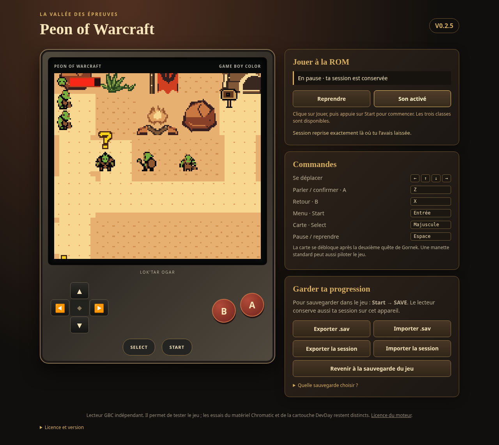

# Browser player for the unchanged v0.2.5 ROM

Download [the standalone browser player](https://raw.githubusercontent.com/GASPARDWALT/peon-of-warcraft/refs/heads/main/releases/browser-player-v0.2.5/peon_of_warcraft_v0_2_5_player.zip), extract it, open `peon_of_warcraft_v0_2_5_player.html` in Chrome or Edge, and click **Jouer**. This single HTML embeds the ROM, JavaScript and WebAssembly; no CDN or additional runtime request is needed.

Keyboard: arrows move, **Z** confirms, **X** cancels, **Enter** opens Start, **Shift** opens Select, **Space** pauses. Touch controls are tested at 390 and 320 pixel widths. Standard gamepads are supported in the code but a physical controller has not been tested.

Use **Start → SAVE** for the native game save. **Exporter .sav** downloads all 32 KiB of SRAM; import it for a normal cold boot and Continue. The distinct **Exporter la session** checkpoint preserves the exact current state and emulated RTC. Automatic checkpoints remain local to this browser/origin; export them before switching devices, sites or clearing browser data. Browser sessions are not cartridge images.

The browser core implements MBC3 and RTC. Its clock advances with emulated CPU time and pauses while the reader is closed. Full checkpoints preserve RTC; a raw 32 KiB .sav contains SRAM only. Physical cartridge RTC behavior is a separate test.

## Playing from the in-app browser

The `gh-pages` branch contains the tested HTML as `index.html`, a license and its manifest. To enable a normal web address, the repository owner must open [GitHub Pages settings](https://github.com/GASPARDWALT/peon-of-warcraft/settings/pages) and choose **Deploy from a branch → gh-pages → /(root) → Save**. After GitHub reports deployment complete, its expected address is `https://gaspardwalt.github.io/peon-of-warcraft/`. Hosting was not enabled or verified during this cloud task: its credentials support Git publication, but the Pages configuration API returned Forbidden.

Once the site is deployed, that address can be opened in Codex's in-app browser. The actual user's in-app display has not been tested. GitHub raw serves an HTML download, not an executable web page; a raw ZIP URL is not a game player.

Local double-click opening cannot be verified in this cloud's managed Chromium because its policy blocks file URLs. All actual browser tests use permitted HTTP, without altering that policy. If your browser rejects the local file and Python is installed, run `python -m http.server 8765` **in the extracted directory on your computer**, then open `http://localhost:8765/peon_of_warcraft_v0_2_5_player.html` on that same computer. A cloud localhost address is not a user-accessible preview. Safari/iPhone remains untested.

## Actual validation

The exact embedded native ROM SHA-256 is `8b19628e4df259b96c4874b1220f238d7d166e6c05d136d7448c6ee9c77aaae8`; it matches the uploaded v0.2.5 file. Chromium QA verifies ordinary Shaman master selection, name entry, The Den, quest acceptance, first boar victory, normal SAVE, byte-exact .sav export, native Continue in a new browser context and full-session reload. It also checks real-time animation frames, nonzero native WebAudio buffers, pause/resume, released keyboard/touch buttons, mute persistence, mobile layout and zero external requests or JavaScript errors. This is one browser gameplay route; the three native class-route suites are documented in the ROM release separately.

Evidence is in [browser validation](../references/generated/browser_player_v025/validation.json) and [core/RTC validation](../references/generated/browser_player_v025/core/validation.json). Twelve full emulator create/run/export/destroy cycles additionally verify correct ROM allocation ownership and descriptor cleanup. Initial failing experiments were retained locally and excluded from the release.



The engine is the MIT-licensed binjgb core pinned to `16621111ed0ee73bcc45c912a823bcebedcffc0f`; its source, binaries and hashes are recorded in `tools/browser_player_vendor/manifest.json`. This independent GBC reader does not use the ModRetro plugin or reproduce a physical Chromatic FPGA/cartridge. No hardware was programmed and DevDay loading is not certified.

## Rebuilding and checking

With the pinned ROM and its matching `pokecrystal.sym` available:

```sh
python3 tools/build_peon_browser_player.py
python3 tools/validate_peon_browser_player.py --expected-sha 8b19628e4df259b96c4874b1220f238d7d166e6c05d136d7448c6ee9c77aaae8
python3 tools/build_peon_browser_player.py --package
```

The validator needs Pillow, Playwright and Chromium. Packaging refuses stale or failed browser evidence and verifies vendored hashes. When the native working ROM has moved on, pass `--rom` pointing to the original v0.2.5 file instead of the default working build. SHA256SUMS in the release identify the exact HTML and ZIP.
