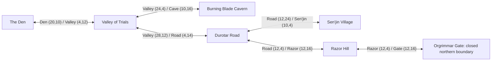

# v0.2.5: road preparation before the seven-area implementation

**Current implementation:** [VALLEY_SEVEN_ZONE_LAYOUT_V025.md](VALLEY_SEVEN_ZONE_LAYOUT_V025.md).
The road-only preparation described below preceded the user's explicit
directional connections. The final native maps now contain five appended
geographic areas, and the former Valley NPC/cave locations described below
have been retired. Use `build_peon_valley_zones_v025.py` and its `zone_layout/`
metadata/validation for the final source and reconstructions. The older
wayfinding script remains an immutable preparatory stage; running it alone
would restore the pre-geographic map bytes.

The path compiler uses the published v0.2.4 commit `6d2a0be` as immutable input.
It changes decoration and painted roads while keeping every original 16×16
movement cell's collision identical. Map numbers, dimensions, warp pairs,
NPC coordinates/order, background interactions and hostile trigger coordinates
remain unchanged. A saved character therefore does not move into a new rock,
and an old harvested cactus still uses its original event flag and coordinate.

Run `python3 tools/build_peon_wayfinding_v025.py` to apply the deterministic
map bytes and create compiler reconstructions. `--check-only` verifies the
current bytes without rewriting maps or PNGs. `--refresh-previews` reads the
latest native tile artwork and exact RGB555 palette files without changing
map bytes. These images contain no emulator-rendered actors and must never be
presented as gameplay screenshots.

## Relationship to the annotated seven zones

The user's annotated map is visible in the conversation. Its numbered/red/
green/off-white version is not a repository source file. The existing files
under `references/zones/valley_of_trials/` and `references/zones/the_den/` remain
terrain/design references; they are not a substitute for that attachment.

| Requested region | Retained implementation and current limit |
| --- | --- |
| 1: The Den, blue vendor camp above purple class camp | The dedicated Den map keeps vendors at movement `(8,6)` and `(8,7)`, Kento at `(6,12)`, and the other two masters west/south. Clear separate paths reach the upper camp, class camp, hut and inn. |
| 2: horizontal route toward the fortified exit | The Valley main road is straightened through block `(6,6)`–`(8,6)`, replacing a redundant southern dogleg. It connects the existing Den entry to the eastern exit. |
| 3: central/northern branching paths | The main junction continues north to the actual cave and south to the existing quest fork. Short visible side branches reach the harvestable cacti and Zureetha. |
| 4: Hana'zua and the Sarkoth quest | The current NPC remains at movement `(10,19)`, south of the main Valley road. This is not yet the requested northwest screen. |
| 5: Sarkoth southwest of zone 4 | The current boss remains at movement `(16,20)`, east of Hana'zua. The existing winding southern branch stays readable, but its geographic placement has not been migrated to the requested southwest screen. |
| 6: cave entrance with level-three hostile imps | The actual entry stays at movement `(24,4)`, with the two existing hostile imps at `(25,6)` and `(27,9)`. The dark rock mouth above its threshold leads into the separately loaded cave. |
| 7: off-white walls framing the eastern exit | The movement `(28,12)` transition stays open. Existing impassable wall blocks immediately east at block `(15,5)`–`(15,7)` frame the passage. |

This release improves the current scrolling world; it does **not** claim the
seven fixed 160×144 camera screens are implemented. The final drawn path
reference has not been supplied. A later migration must deliberately append
map IDs, translate saved player/bound-inn positions and update the atlas rather
than silently repositioning Hana'zua, Sarkoth, the cave or saved characters.

## Current native topology

Coordinates in this diagram are 16×16 movement cells. The door art uses 32×32
blocks, so a block coordinate is obtained by dividing each movement coordinate
by two and rounding down.

There is no exit warp inside the northern Orgrimmar wall. Its previous
`cavern_mouth` artwork at block `(6,2)` falsely suggested a cave. It now uses
the closed `fortified_gate_wall` ID 33 with the exact same four WALL collisions.
The real Burning Blade cave remains the sole exterior cave opening.

## Door art must agree with collision

All nine linked exterior building doors use the **bottom-right quadrant** of
their 32×32 block: local pixels `x=16..31`, `y=16..31`. The other three
quadrants remain WALL. The earlier central openings extended into a blocked
bottom-left quadrant; the new art must keep its navigable opening clearly in
the bottom-right quadrant.

| Exterior | Door movement cells | Native block IDs |
| --- | --- | --- |
| The Den | `(17,5)` inn; `(5,7)` large Den/hut | 4; 11 |
| Sen'jin | `(5,5)` hut; `(15,5)` inn; `(17,9)` hut | 29 |
| Razor Hill | `(5,5)` hut; `(17,5)` inn; `(17,13)` hut; `(5,15)` hut | 4 |

The Razor southwest doorway `(5,15)` is a special case: the existing palisade
immediately south is WALL. Its valid approach is from the east at `(6,15)`.
The new east footpath and an opening visible at the door's right edge make
that approach readable; the southern fence remains intact.

The Valley cave mouth is WALL block 15 at block `(12,1)`. The actual open
threshold is block 16 immediately below at `(12,2)`, movement `(24,4)`. Block
16 keeps all four WARP_PANEL quadrants, including other zone transitions.
Decorative arches must never draw an apparent closed gate over these cells.

## Painted path changes and static verification

There are 31 new beaten-earth blocks. Ten obsolete road blocks become bare
soil: six redundant Den lanes and four blocks of the Valley's old dogleg. Road
shape changes at neighboring junctions bring the total to 70 map-byte changes.

| Map | Changed blocks | New path blocks | Removed redundant path blocks |
| --- | ---: | ---: | ---: |
| The Den | 20 | 5 | 6 |
| Valley of Trials | 20 | 8 | 4 |
| Durotar Road | 5 | 3 | 0 |
| Sen'jin Village | 9 | 6 | 0 |
| Razor Hill | 15 | 9 | 0 |
| Orgrimmar Gate | 1 | 0 | 0 |
| Opening, Grommash Hold, cave and four interiors | 0 | 0 | 0 |

The generator validates before writing:

- Every old/new movement-cell collision is exactly equal, including door and
  transition quadrants.
- Every map's original dimensions, full event coordinates/arguments and actor
  order remain unchanged.
- All warps remain connected; every ordinary NPC/background interaction has
  a reachable adjacent movement cell.
- Every painted road belongs to its map's main connected road component.
- All nine actual hut-door quadrants retain their reachable approaches.
- The thirteen map arrays retain their prior identity; no new map IDs or
  duplicated rooms are created.

The per-map before/after byte hashes and checks are in
`references/generated/environment_v025/paths/validation.json`.
The annotated reconstructions are in `paths/annotated/`; cyan boxes mark
actual warp cells and amber boxes mark newly painted road blocks. These static
checks accompany native emulator door/cave/save tests performed for the final
ROM; they do not themselves prove emulator execution.
