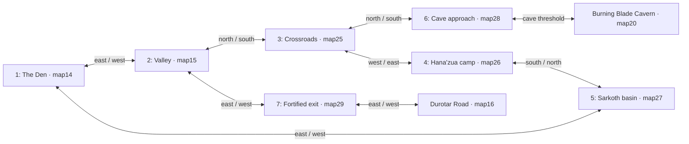

# Seven Valley areas: v0.2.5 native geography

The user's directional clarification is now implemented as seven connected
geographic areas. The Den is zone 1, its eastern Valley area is zone 2, and
five compact maps append native IDs 25–29 for zones 3–7. The original map IDs
and dimensions remain stable for existing saves. The older road-only plan in
`ENVIRONMENT_V025_PATHS.md` describes the preparation before this change and
is not the final geographic source.

## Actual connections

| Source | Warp movement cell | Destination | Return movement cell |
| --- | --- | --- | --- |
| Zone 1, Den | `(20,10)` warp1 | Zone 2 | `(4,12)` warp1 |
| Zone 2 | `(16,0)` warp3 | Zone 3 | `(5,9)` warp1 |
| Zone 3 | `(0,4)` warp3 | Zone 4 | `(9,4)` warp1 |
| Zone 4 | `(5,9)` warp2 | Zone 5 | `(5,0)` warp1 |
| Zone 5 | `(9,7)` warp2 | Zone 1 | `(0,14)` warp4 |
| Zone 3 | `(5,0)` warp2 | Zone 6 | `(5,9)` warp1 |
| Zone 6 | `(5,2)` warp2 | Cavern | `(10,16)` warp1 |
| Zone 2 | `(28,12)` warp2 | Zone 7 | `(0,4)` warp1 |
| Zone 7 | `(9,4)` warp2 | Durotar Road | `(4,14)` warp1 |

Every portal has a statically verified reciprocal return. The compact maps
are 5×5 native 32×32 blocks, or 160×160 pixels/10×10 movement cells. They keep
Crystal's scrolling camera; fixed 160×144 camera screens are not claimed.
Zones 1 and 2 retain their larger scrolling dimensions so established class
camps, shops, hut doors, cactus coordinates and saved positions remain valid.

## Landmarks and retired duplicate locations

- **Zone 1:** vendors and the three class masters keep their original Den
  positions. Existing hut/inn warps 2 and 3 remain unchanged; the western
  canyon return is appended as warp 4.
- **Zone 2:** Galgar stays at `(8,10)` and the three harvestable cacti stay at
  `(7,7)`, `(23,9)`, `(9,17)`, with the original persistent flags and tile
  callbacks. A visible central canyon path leads north to zone 3.
- **Zone 3:** Zureetha moves to `(6,4)`, object3. Her quest marker is object7
  at `(6,3)`; her familiar/medallion sequence and rewards remain the original
  script.
- **Zone 4:** Hana'zua moves to `(3,4)`, object2, with object6's quest marker
  at `(3,3)`. His quest now directs the player into the adjacent southern
  Sarkoth basin.
- **Zone 5:** Sarkoth moves to `(4,4)`, object4. Its four adjacent proximity
  cells invoke the retained encounter script; its old permanent victory flag
  removes the boss and prevents retriggering.
- **Zone 6:** the two level-three familiars move to `(4,5)` and `(6,4)`,
  objects8/9. Their original two death flags remain valid. The rock mouth and
  threshold are the sole exterior entrance to the existing cavern.
- **Zone 7:** off-white fortifications frame a horizontal open gate, with a
  Horde standard, campfire and stationary guard. The road continues east.

The old Valley positions for Hana'zua, Zureetha, Sarkoth, their two markers
and the two outdoor familiars now have `SPRITE_NONE`. Their source object
indices are retained, but `CheckObjectFlag` masks sprite zero before actor/OAM
allocation. All obsolete Valley proximity events are removed. The old cave
mouth is closed stone; its former threshold `(24,4)` remains ordinary walkable
ground for a saved character, and contains no cave warp. Old dead enemies do
not reappear in the new zones, and the obsolete map does not contain duplicate
active quest givers or boss encounters.

New nodes use invisible placeholder records to retain the original Valley
object indices. Their local event stubs `farsjump` into the existing quest and
battle scripts in the old bank. This preserves portraits/`setlasttalked`, enemy
`disappear` indices, one-time XP/copper/item rewards, rare-potion hooks and
loss recovery without duplicating business logic or renumbering flags.

## Save/navigation contract

The tileset's 47 collision rows are byte-for-byte equivalent. Every old
non-WALL movement cell remains non-WALL. Only six specifically authorized
old WALL blocks open to make new passages: Den `(0,7)` and Valley `(8,0)`,
`(8,1)`, `(8,2)`, `(8,4)`, `(8,5)`. The floor at Valley `(8,3)` remains
walkable and becomes a road. Existing bound-inn homes and nine exterior hut
door cells remain stable. The cavern's old map ID and interior coordinates
stay unchanged; its exit now returns to the new zone-six threshold.

The current Continue loader refreshes Peon terrain, callbacks and object data
after the old saved screen overlay. This makes retired NPCs/new paths visible
without moving a saved character. Quest progress, death flags, inventory,
character class, health and spell charges are not migrated or reset by this
map builder. Root integrates separate sector-discovery flags in reserved bits
342–348 for the new overall Valley map; class bits 318–341 are not touched here.

## Reproduction and evidence

Run `python3 tools/build_peon_valley_zones_v025.py` to generate the final native
map bytes. It includes the immutable `6d2a0be` road preparation internally;
do not run the old path-only builder afterwards. `--check-only` verifies the
deterministic current bytes, while `--refresh-previews` checks and redraws
the current native tile art and exact palette files without changing maps.

`references/generated/environment_v025/zone_layout/metadata.json` contains
the map IDs, dimensions, indexed portal pairs, actor indices/flags, quest
landmarks and approximate rectangle positions from the user's annotated
conversation image. The original annotated attachment is not falsely
represented as a stored repository reference. Its relative rectangles guide
the review diagram and the overall atlas.

`zone_layout/validation.json` verifies all 18 map arrays are distinct, all
portals connected and reciprocal, every visible actor/background interaction
approachable, all old saved floor retained, all 47 collision rows unchanged,
and old duplicate encounter/quest locations retired. `zone_layout/maps/` and
`annotated/` contain compiler reconstructions with explicit labels. Native
emulator route/quest/cave/cold-save checks accompany the final ROM separately;
compiler pictures alone are not proof of gameplay.
